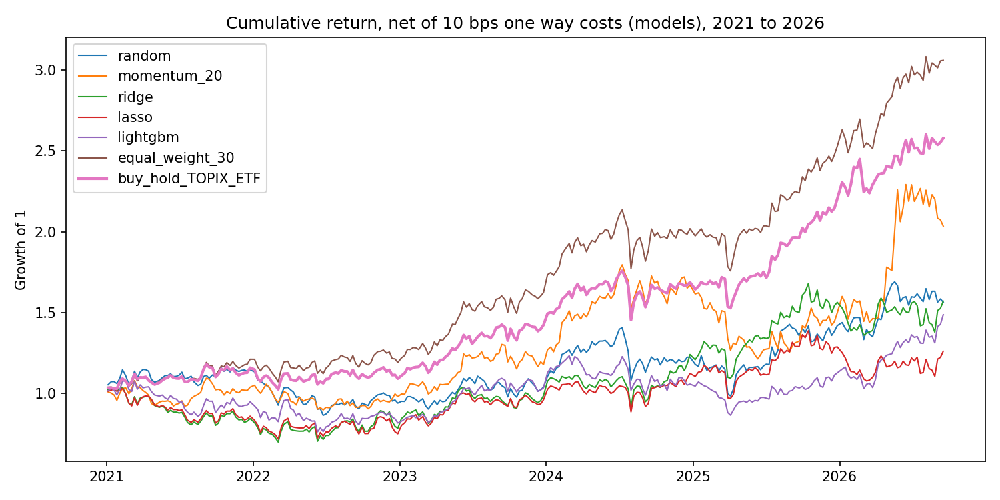

# Walk Forward Backtesting of Return Prediction Models

Can simple price and volume features rank Japanese large cap stocks by their next 5 day return, out of sample? This project builds a leakage tested walk forward pipeline and reports the answer honestly.

**Main finding:** No model showed a statistically reliable out of sample ranking ability. Ridge, Lasso and LightGBM did not beat naive baselines, and every top 5 strategy underperformed equal weight and index buy and hold after costs.

## Data
Daily adjusted prices from Yahoo Finance (yfinance) for 30 Japanese large cap stocks plus the TOPIX ETF (1306.T) as a benchmark, January 2016 to September 2026. The stock list was chosen by hand from today's large companies across sectors.

Data cleaning (src/clean_data.py):
1. Rows on market holidays (zero volume and High equal to Low) are removed, 689 rows.
2. Two data source errors were found by scanning for extreme daily moves and removed with documented reasons: 1306.T on 2026-03-30 and 31 (price drops to about one tenth, then recovers), and 8766.T after 2026-09-28 (artificial jump around a stock split date, adjustment appears inconsistent). Other large moves match real market events and were kept.

## Method
Features (src/features.py), all using data up to day t only: momentum over 5, 20 and 60 days, 20 day volatility, 20 day volume change. Target: return over the next 5 trading days. For model training the target is demeaned across stocks each day, so models learn ranking rather than market direction.

Validation (src/walkforward.py): expanding window walk forward. Training starts in 2016, the first test year is 2021, and each test window is one year, 6 windows in total. Training data always precede the test data, with a 5 day gap because the target looks 5 days ahead.

Models (src/models.py): random baseline, 20 day momentum baseline, ridge, Lasso, LightGBM. Hyperparameters were fixed in advance and not tuned on test data.

Evaluation: daily rank information coefficient (Spearman correlation between predicted and realized return ranks across stocks), and a backtest (src/backtest.py): every 5 trading days buy the 5 highest ranked stocks, equal weight, with 10 bps one way cost, compared with equal weight holding of all 30 stocks and with the TOPIX ETF.

## Results

Rank IC, 2021 to September 2026 (1398 test days):

| Model | Mean IC | t stat | Share of positive days |
|---|---|---|---|
| Random | -0.0015 | -0.31 | 0.499 |
| Momentum 20 | -0.0056 | -0.77 | 0.494 |
| Ridge | -0.0087 | -1.14 | 0.489 |
| Lasso | -0.0080 | -1.04 | 0.491 |
| LightGBM | -0.0056 | -1.03 | 0.506 |

Backtest, net of costs for the model rows:

| Strategy | Annual return | Sharpe | Max drawdown |
|---|---|---|---|
| Random top 5 | 8.4% | 0.48 | -29.9% |
| Momentum top 5 | 13.6% | 0.64 | -32.4% |
| Ridge top 5 | 8.5% | 0.45 | -32.5% |
| Lasso top 5 | 4.3% | 0.30 | -30.3% |
| LightGBM top 5 | 7.4% | 0.44 | -29.8% |
| Equal weight 30 stocks | 22.3% | 1.21 | -17.6% |
| TOPIX ETF buy and hold | 18.7% | 1.09 | -17.3% |



Interpretation: all mean ICs are close to zero with t statistics inside plus or minus 2, so there is no evidence of predictive power from these features. The momentum baseline has the highest Sharpe among the top 5 strategies, but its IC is not positive and the gap to the other strategies is within noise for a single historical path, so I do not read it as evidence that momentum works.

## Regularization in geophysics and in finance
Ridge regression minimizes data misfit plus a penalty on the size of the coefficients. This has the same form as Tikhonov regularization in geophysical inversion, where a penalty on the model stabilizes an ill posed problem. Lasso uses an L1 penalty, which pushes some coefficients exactly to zero. In both settings the data are noisy and an unregularized fit would match the noise. The difference is that in inversion the forward physics is known and regularization selects a plausible model, while in return prediction there is no known law, the signal is extremely weak, and regularization mainly guards against overfitting noise. Honest validation matters more in the second case.

## Limitations
1. Survivorship bias: the stocks are today's large companies, which flatters buy and hold results.
2. The sample period 2021 to 2026 was a strong period for Japanese equities, and the backtest is a single historical path.
3. t statistics are optimistic because 5 day returns on adjacent days overlap.
4. The backtest trades at the signal day close, which is more optimistic than real execution. Equal weight and ETF rows include no costs.
5. Only 5 simple price and volume features and 30 stocks. No fundamentals, no tuning of hyperparameters.
6. Yahoo Finance data can contain errors. Two were found, others may remain.

## Reproduce (tested on macOS, Python 3.9)
```bash
python3 -m venv .venv
source .venv/bin/activate
pip install -r requirements.txt
python src/download_data.py
python src/clean_data.py
python src/features.py
python -m src.run_models
python -m src.run_backtest
pytest -q
```

## Tests
Tests check that features do not change when future prices are altered (no leakage), that the target is the forward return, that walk forward windows keep training before testing, that cleaning removes only the intended rows, and that backtest costs and drawdown are computed correctly.
